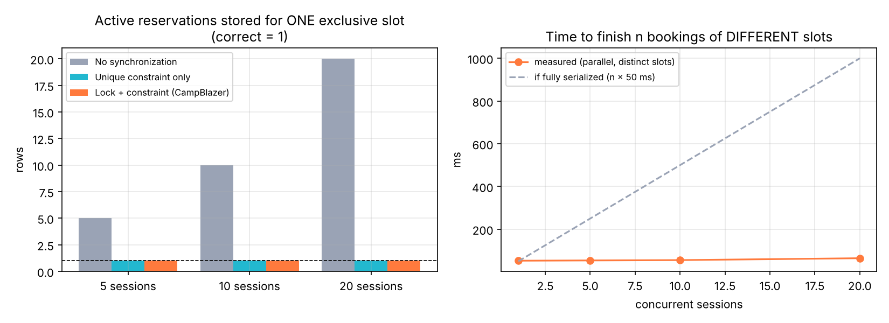

# CampBlazer: A Distributed, Concurrency-Safe Camping Destination Discovery and Reservation Platform for Biliran Province

*Capstone project, Parallel and Distributed Computing. Biliran Province State University.*

> **How to read this document.** It describes what is implemented in the source code. Results are measured only.
> Section 14.3 holds measurements actually taken (PostgreSQL layer, November 19, 2026). Tables marked **[RUN LOCALLY]**
> are filled from the output of the included scripts once the full Django system is running on the team's machine.
> Don't put numbers in those tables that the scripts didn't produce.

---

## 1. Project Title and Description
**CampBlazer** is a web platform where visitors explore beach and mountain destinations in **Biliran Province only**, see verified details, check live availability, and reserve either a **beach venue** or a **mountain tour guide**. It is built as a client–server distributed system: a React + TypeScript browser client, a multi-worker Django REST API, and a PostgreSQL database. Concurrent reservation requests are handled safely.

## 2. Background and Problem Identification
Planning a camping trip to Biliran's beaches and mountains is hard. Information is spread across social-media pages, blogs and government listings. It is difficult to check availability. Reservations are made by message or phone call, with no shared record of which slots are already taken. Two visitors can be promised the same cottage or the same guide on the same day.

## 3. Objectives
**General:** Build a working, centralized discovery and reservation platform for Biliran camping destinations that demonstrates sound parallel and distributed computing principles.

**Specific:**
1. Provide a Biliran-only catalog of 11 beach and 8 mountain listings, with filters by category and municipality and a search function.
2. Implement two distinct reservation workflows: beach venue booking and mountain tour-guide booking.
3. Implement a REST client–server architecture served by multiple concurrent workers.
4. Guarantee that an exclusive slot can never hold more than one active reservation, even under simultaneous requests.
5. Measure response time, throughput, error rate and scalability at 1, 5, 10 and 20 concurrent users.
6. Apply secure authentication, role-based authorization and input validation.

## 4. Scope and Limitations
**Scope:** Biliran Province's 8 municipalities (Almeria, Biliran, Cabucgayan, Caibiran, Culaba, Kawayan, Maripipi, Naval). The system has four roles: camper, beach venue operator, mountain guide, and administrator.
**Limitations:** Payments are simulated (no payment gateway). Bookings are only enabled for services an administrator has verified. The two demo services are clearly simulated. Photos must be added by administrators, with a credit and a licence. They can be uploaded or linked, and two verified Wikimedia Commons photos are seeded (see docs/PHOTO_SOURCES.md). Several mountain locations are still marked *pending verification* (Section 13.2). The system is deployed on a single host. Multiple servers behind a load balancer are discussed in Section 17 as future work.

## 5. Target Users and User Requirements
| User | Main requirements | Implemented in |
|---|---|---|
| Visitors / campers | Explore, filter, view details, check availability, reserve, cancel, view history | Explore, Details, Dashboard pages; `/api/destinations`, `/api/bookings/*` |
| Beach venue operators | Manage venue slots, approve or reject reservations | Operator dashboard; `/api/operator/*` (scoped to their own venues) |
| Mountain tour guides | Manage tour schedules, approve or reject bookings | Operator dashboard; `/api/operator/*` (scoped to their own guide profile) |
| Administrator | Users and roles, destinations, verification, services, prices, availability, reservations, statistics | Admin dashboard; `/api/admin/*` |

## 6. Proposed Solution
A single platform with two booking categories that are kept apart:
- **Beaches → Venue booking.** Each beach has `BeachVenue` records, and each venue has `VenueSlot` records (date and time windows).
- **Mountains → Tour-guide booking.** Each mountain has `MountainGuide` records, and each guide has `GuideSchedule` records.

The two inventories are stored in separate tables and served by separate endpoints. They are never merged into one generic booking.

## 7. Business Model (proposed, not operating)
| Element | Proposal |
|---|---|
| Customers | Tourists, campers, students, outdoor groups |
| Providers | Beach venue operators, local mountain guides |
| Value proposition | One place to discover Biliran destinations and reserve without double-booking |
| Revenue options | Commission per confirmed booking, listing fee for operators, optional featured placement |
| Key partners (to be approached) | Provincial and municipal tourism offices, verified operators, accredited guides |
| Costs | Hosting, domain, managed PostgreSQL, maintenance, development |

No partnerships, agreements or revenue exist yet. These are proposed strategies.

## 8. System Features and Workflows
- **Public:** home (hero, featured beaches and mountains, how it works, why CampBlazer, call to action), explore page (category tabs, search, municipality filter), destination details (gallery, amenities, activities, prices, services, availability, instructions).
- **Accounts:** register, log in, log out, edit profile. Passwords are hashed with PBKDF2-SHA256.
- **Camper dashboard:** reservations grouped by status (Pending, Approved, Rejected, Cancelled, Completed), price breakdown, status history, and cancellation of eligible reservations.
- **Operator/guide dashboard:** add, close, reopen and delete slots or schedules; approve, reject or complete reservations.
- **Admin dashboard:** statistics; destination management (add, edit, delete, verify, enable or disable bookings, feature, photos with credit); venue and guide management (prices, capacity, verification); availability; all reservations; user roles and activation.
- **Status lifecycle:** PENDING → APPROVED/REJECTED/CANCELLED; APPROVED → COMPLETED/CANCELLED. Every change is written to `BookingHistory`.

## 9. System Architecture and Design Diagrams
```
 Many users (browsers: React + TypeScript)
   │  HTTPS / JSON (REST)   +   WebSocket /ws/live/ (push)
   ▼
 ┌──────────────── Django + DRF server ────────────────┐
 │  gunicorn master                                     │
 │   ├── worker process 1 ─┐                            │
 │   ├── worker process 2 ─┤ each: own Python process,  │
 │   ├── worker process 3 ─┤ own DB connection          │
 │   └── worker process 4 ─┘                            │
 │  bookings/services.py: transaction.atomic()          │
 │  bookings/realtime.py: on_commit → Redis pub/sub     │
 │                        select_for_update()           │
 └──────────────────────────┬───────────────────────────┘
          ┌─────────────────┤ SQL over TCP
          ▼                 ▼
 ┌──── Redis ────┐  (channel layer: WebSocket events between workers)
 └───────────────┘
 ┌──────────────── PostgreSQL ─────────────────────────┐
 │ row-level locks (SELECT … FOR UPDATE)                │
 │ partial UNIQUE index: 1 active reservation per slot  │
 │ EXCLUDE (gist): no overlapping slots per venue/guide │
 │ CHECK: Biliran-only; booking requires verification   │
 └──────────────────────────────────────────────────────┘
```

## 10. Parallel and Distributed Computing Implementation
| Concept | How CampBlazer implements it |
|---|---|
| **Distributed computing** | The browser client and the Django server are separate processes that communicate over the network through HTTP/REST. The server talks to PostgreSQL, a third process, over TCP. |
| **Parallel / concurrent processing** | gunicorn runs **4 ASGI worker processes** (uvicorn workers, `gunicorn.conf.py`), and each one handles requests independently. On Windows, `run_server_windows.py` starts 4 uvicorn worker processes. The `X-Worker-PID` response header proves which process served each request. |
| **Shared resource** | One `VenueSlot` row (beach) or one `GuideSchedule` row (mountain) in PostgreSQL. |
| **Synchronization** | `transaction.atomic()` + `select_for_update()` (row lock). The availability check is repeated while the lock is held. A partial unique index serves as a second, independent guarantee. |
| **Real-time push (distributed messaging)** | Django Channels + **Redis** channel layer. Every worker subscribes to Redis. The worker that commits an approval publishes the event, and Redis delivers it to whichever worker holds that user's WebSocket. Events carry `published_by_pid` and `delivered_by_pid` to show the cross-process path. |
| **Data consistency** | PostgreSQL is the single source of truth. No availability is cached in application memory. |

This project does **not** use shared-memory parallelism. The workers are separate processes that coordinate only through the database. Also, database locking by itself does not prove that requests ran in parallel. Parallel handling is shown separately, by several distinct worker PIDs serving requests at the same time (`scripts/concurrency_test.py`, `scripts/load_test.py`, and the live demo on the *How it works* page).

## 11. Client–Server Communication
1. The user interacts with the frontend.
2. The frontend sends an HTTP request (for example `POST /api/bookings/beach/`) with a token.
3. A Django worker receives it.
4. The backend validates the input and processes the operation.
5. The backend queries or updates PostgreSQL.
6. The database returns data.
7. The backend responds with JSON (201, 400, 401, 403 or 409).
8. The frontend displays the confirmation, or refreshes availability after a 409.

## 11a. Real-time Updates (WebSockets + Django Channels + Redis)
**Problem:** without push, a camper only learns that the operator approved their booking when they reload the page, or after a polling interval of 10–15 seconds.
**Implementation:**
1. The browser opens one WebSocket to `/ws/live/` (`frontend/src/lib/realtime.tsx`). It sends `{"type":"auth","token":…}` as its first message, so the token never appears in URLs or logs. It reconnects automatically with exponential backoff.
2. `bookings/consumers.py` joins the socket to groups: `user_<id>`, `provider_<id>` (operators and guides), `admins`, and `dest_<slug>` (whoever is viewing a destination page).
3. When the operator approves, `services.change_status` updates PostgreSQL inside `transaction.atomic()` and registers `realtime.status_changed(...)` with **`transaction.on_commit`**. The event is sent only after the commit succeeds, so a rolled-back change is never announced.
4. `channel_layer.group_send` publishes through **Redis pub/sub** to every worker. The worker holding that camper's socket forwards the JSON event, and the dashboard updates and shows a toast immediately.
5. New bookings also push `availability.changed`, so other people viewing the same destination see that slot become "booked" without refreshing.

**Events:** `reservation.status` (approved, rejected, cancelled, completed), `reservation.new` (sent to operators/guides and admins), `availability.changed`.
**Security:** handshakes are checked against ALLOWED_HOSTS (`AllowedHostsOriginValidator`). Private events require a valid token, and an invalid token gets `auth.error` and no private events.
**Tests (`RealtimeTests`):** an approval is pushed to the camper; an invalid token gets no private events; watchers receive `availability.changed`; a booking rolled back by a conflict produces no event. [RUN LOCALLY] Record the measured delivery time printed by the test: ____ ms.
**Fallback:** if Redis is down, the booking still succeeds. The event is logged, and the data appears on the next page load.

## 12. Concurrency and Synchronization Mechanisms
`backend/bookings/services.py`:
```python
with transaction.atomic():
    slot = VenueSlot.objects.select_for_update().get(pk=slot_id)   # row lock
    ... verify destination / venue / slot open / future / capacity ...
    if slot.reservations.filter(status__in=ACTIVE_STATUSES).exists():
        raise SlotUnavailable          # -> HTTP 409
    BeachReservation.objects.create(...)
    BookingHistory.objects.create(...)
# commit -> lock released
except IntegrityError -> SlotUnavailable (partial unique index safety net)
```
The mountain workflow has the same structure, using `GuideSchedule`. The winner is whichever transaction **acquires the lock first** inside PostgreSQL. It is not necessarily the first user to click. The losing transactions wait on the lock, then re-read the slot and receive 409.

Database constraints (`bookings/models.py`, `destinations/models.py`):
- `one_active_reservation_per_venue_slot` / `…_per_guide_schedule`: partial UNIQUE on `slot` WHERE status IN (PENDING, APPROVED).
- `venueslot_no_overlap` / `guideschedule_no_overlap`: EXCLUDE USING gist, so a venue or guide can't have overlapping time ranges.
- `destination_biliran_only`, `booking_requires_verification`: CHECK constraints.

## 13. Database Design
### 13.1 Entities
`User` (Django), `UserProfile` (role, phone), `Destination`, `DestinationImage` (URL + required credit), `BeachVenue`, `MountainGuide`, `VenueSlot`, `GuideSchedule`, `BeachReservation`, `GuideReservation`, `BookingHistory`. `BookingStatus` is a choices type with the values PENDING, APPROVED, REJECTED, CANCELLED and COMPLETED.

Relationships:
- Destination 1–N BeachVenue 1–N VenueSlot 1–N BeachReservation
- Destination 1–N MountainGuide 1–N GuideSchedule 1–N GuideReservation
- Each reservation 1–N BookingHistory
- A reservation references its slot with `on_delete=PROTECT`, so booking history can't be erased by deleting a slot.

### 13.2 Approved catalog (final list, 18 destinations)
| # | Beach (venue booking) | Municipality | Location verified |
|---|---|---|---|
| 1 | VRC Beach Resort | Almeria (Brgy. Talahid) | Yes |
| 2 | Paradizu Bayview Resort | Almeria (Brgy. Talahid) | Yes |
| 3 | Coco Grove Beach Resort | Almeria (Brgy. Talahid) | Yes |
| 4 | Agta Beach Resort | Almeria (Brgy. Talahid) | Yes |
| 5 | Higatangan Island | Naval | Yes |
| 6 | Dalutan Island | Almeria | Yes |
| 7 | Chamorita Beach Resort | Naval (Brgy. Catmon) | Yes |
| 8 | Napo Beach Resort | Maripipi (Brgy. Viga) | Yes |
| 9 | Agpangi Brown Beach | Naval (Brgy. Agpangi) | Yes |
| 10 | Cogon Beach Resort | Kawayan | Pending (barangay) |
| 11 | Alegre Beach Resort | no source found | Pending |
| 12 | Francis' Place | no source found | Pending |

| # | Mountain (tour-guide booking) | Municipality | Location verified |
|---|---|---|---|
| 1 | Mount Tres Marias | Almeria (jump-off Brgy. Sampao) | Yes |
| 2 | Mount Panamao | northern tip of Biliran; municipality not confirmed | Pending |
| 3 | Mount Suiro (Ascuero) | Caibiran (jump-off Sitio Ansay, Brgy. Union) | Yes |
| 4 | Mount Naliwatan | Almeria jump-off; boundary unconfirmed | Pending |
| 5 | Mount Sayoa | not yet confirmed | Pending |
| 6 | Camp Beben | Kawayan (provincial site tag; barangay unstated) | Pending |

The approved list contained Agta Beach Resort twice, so it is stored once (18 destinations). `seed_destinations` deletes every other destination, together with its photos, services, slots and reservations. All 18 are marked verified with bookings enabled. Each has a photo (`backend/seed_photos/`). The Book Venue / Book Tour Guide button becomes active once a verified venue or guide with open slots exists. For the demonstration, `seed_demo` creates one simulated **[DEMO]** service per destination. Sources are recorded in each record's `source_notes`.

## 14. Testing Procedures and Results
### 14.1 Automated tests (`backend/bookings/tests.py`): [RUN LOCALLY]
| Group | Tests |
|---|---|
| Functional | register/login/logout and password hashing; catalog filters, search, details; separate availability endpoints; beach booking with price check and 409 on a second attempt; mountain booking; input validation; unverified destination can't be enabled; cancel, history, slot freed |
| Security | anonymous user can't book; camper gets 403 on admin and operator APIs; user can't cancel someone else's booking; operator limited to own venue; registration can't request the admin role; DB rejects overlapping slots; DB rejects a duplicate active reservation |
| Concurrency | 12 threads with 12 DB connections released by a barrier on one beach slot, and the same for one guide schedule: expect 1 success and 11 conflicts |

Run `python manage.py test -v 2` and record pass/fail counts here: ____ passed / ____ failed.

### 14.2 HTTP concurrency test (`scripts/concurrency_test.py`): [RUN LOCALLY]
| Kind | Simultaneous requests | 201 | 409 | Other | Distinct worker PIDs | Avg ms | Max ms | Consistent |
|---|---|---|---|---|---|---|---|---|
| beach | 10 | | | | | | | |
| beach | 20 | | | | | | | |
| mountain | 10 | | | | | | | |
| mountain | 20 | | | | | | | |

### 14.3 PostgreSQL-layer race test: measured
**Procedure:** `db_concurrency_test/run_db_concurrency_test.py`. Each session is a separate `psql` process, so it is a separate PostgreSQL backend process. All sessions wait until the same timestamp (`pg_sleep_until`) and then run the same booking transaction used in `services.py`, with 50 ms of simulated work inside the critical section. **Environment:** PostgreSQL 16.15, 2 vCPU Linux sandbox, November 19, 2026.

Three designs were compared on **one exclusive slot**:
- **none:** no lock and no unique index (unsafe baseline)
- **constraint_only:** unique index only
- **locked:** `SELECT … FOR UPDATE` plus unique index (the CampBlazer design)

| Scenario | Sessions | Success | Conflict (after lock) | Conflict (constraint) | Active rows stored | Consistent | Backend PIDs | Avg ms | Max ms | Max lock wait ms |
|---|---|---|---|---|---|---|---|---|---|---|
| same-slot/none | 5 | 5 | 0 | 0 | 5 (max 1) | NO | 5 | 52.53 | 54.17 | 0.14 |
| same-slot/constraint_only | 5 | 1 | 0 | 4 | 1 (max 1) | YES | 5 | 53.54 | 55.57 | 0.1 |
| same-slot/locked | 5 | 1 | 4 | 0 | 1 (max 1) | YES | 5 | 53.67 | 54.29 | 53.48 |
| same-schedule/locked | 5 | 1 | 4 | 0 | 1 (max 1) | YES | 5 | 54.2 | 56.1 | 55.24 |
| same-slot/none | 10 | 10 | 0 | 0 | 10 (max 1) | NO | 10 | 53.52 | 59.66 | 0.69 |
| same-slot/constraint_only | 10 | 1 | 0 | 9 | 1 (max 1) | YES | 10 | 52.5 | 53.98 | 0.16 |
| same-slot/locked | 10 | 1 | 9 | 0 | 1 (max 1) | YES | 10 | 56.47 | 60.06 | 59.14 |
| same-schedule/locked | 10 | 1 | 9 | 0 | 1 (max 1) | YES | 10 | 58.01 | 62.04 | 61.2 |
| same-slot/none | 20 | 20 | 0 | 0 | 20 (max 1) | NO | 20 | 52.64 | 59.91 | 0.15 |
| same-slot/constraint_only | 20 | 1 | 0 | 19 | 1 (max 1) | YES | 20 | 52.77 | 57.0 | 0.62 |
| same-slot/locked | 20 | 1 | 19 | 0 | 1 (max 1) | YES | 20 | 70.29 | 84.58 | 83.52 |
| same-schedule/locked | 20 | 1 | 19 | 0 | 1 (max 1) | YES | 20 | 66.29 | 80.22 | 79.4 |
| distinct-slots/locked | 1 | 1 | 0 | 0 | 1 (max 1) | YES | 1 | 52.63 | 52.63 | 0.68 |
| distinct-slots/locked | 5 | 5 | 0 | 0 | 5 (max 5) | YES | 5 | 52.81 | 53.9 | 0.81 |
| distinct-slots/locked | 10 | 10 | 0 | 0 | 10 (max 10) | YES | 10 | 53.52 | 55.43 | 2.55 |
| distinct-slots/locked | 20 | 20 | 0 | 0 | 20 (max 20) | YES | 20 | 55.01 | 64.27 | 8.98 |



**Findings:**
1. **Without synchronization the race condition is real.** With 20 simultaneous sessions, 20 reservations were stored for a slot that should hold one. That is 19 double-bookings.
2. **The unique index alone keeps the data consistent.** The losing sessions fail when they try to insert, after doing their work.
3. **Lock plus constraint** (CampBlazer) also keeps the data consistent. The losing sessions wait for the lock (up to 83.5 ms with 20 sessions), then cleanly see that the slot is taken. They never reach the insert. The same behaviour holds for guide schedules.
4. **Locks only serialize conflicting work.** When 20 sessions booked 20 *different* slots, all of them succeeded, and the slowest one finished in 64.27 ms. If the sessions had run one after another with 50 ms of work each, they would have needed about 1,000 ms. That figure is theoretical and is shown as the dashed line in the chart.

These results test the **database synchronization layer**. They do not measure Django end-to-end throughput, which is covered in Section 15.

## 15. Performance Evaluation and Analysis: [RUN LOCALLY]
Run `scripts/load_test.py` with 1 worker and then with 4 workers, then run `--report`. Paste in `scripts/results/load_report.md` and `load_charts.png`.

| Workers | Users | Requests | Throughput (req/s) | Avg (ms) | p95 (ms) | Error rate | Distinct PIDs |
|---|---|---|---|---|---|---|---|
| 1 | 1 / 5 / 10 / 20 | | | | | | |
| 4 | 1 / 5 / 10 / 20 | | | | | | |

Speedup is S(p) = T(1 worker) / T(p workers), and efficiency is E(p) = S(p) / p, both computed by the script from the measured wall times. Expect efficiency below 1, because all workers share one PostgreSQL server and one machine's CPU cores.

**Bottlenecks to discuss once results are available:**
- One PostgreSQL instance for all workers.
- Lock contention on a popular slot. This is intended, and it adds latency only for that one slot.
- Python worker count is limited by CPU cores.
- No caching of the public catalog.
- Every request opens a DB connection unless `CONN_MAX_AGE` keeps connections alive (it is set to 60 s).

## 16. Security and Privacy Considerations
- **Passwords:** hashed with Django PBKDF2-SHA256 and checked against password validators.
- **Authentication:** token auth. The token is deleted on logout.
- **Authorization:** role-based (`accounts/permissions.py`). Operators and guides are limited to their own services. Self-registration always creates a camper account.
- **Input validation:** DRF serializers (regex for phone and username, email, numeric ranges, length limits) plus database CHECK constraints.
- **Rate limiting:** login and anonymous throttles.
- **Configuration:** secrets come from environment variables (`.env`, which is not committed).
- **Security headers:** nosniff and `X-Frame-Options: DENY`. Cookies are secure when `DEBUG` is off. CSRF protection applies to session-authenticated use; token-authenticated API calls are not vulnerable to CSRF.
- **Privacy:** reservation contact details are visible only to the booker, the operator or guide of that service, and admins. The demo uses simulated accounts.

## 17. Limitations and Recommendations
- **Photos:** add authentic, licensed photos with credit (sources include the provincial tourism office and photos the team takes or gets permission for).
- **Verification:** confirm the municipalities still marked *pending*, and verify real operators and guides before enabling bookings.
- **Payments:** integrate a payment gateway (for example GCash or Maya through a provider). Payments are currently simulated.
- **Scale:** to scale out, run several app servers behind a load balancer, add a PostgreSQL read replica for the catalog, and cache public pages (Redis).
- **Notifications:** add email or SMS notifications for status changes.

## 18. Conclusion
CampBlazer turns scattered information about Biliran destinations into a single, verifiable catalog with two separate booking workflows. Its client–server architecture serves requests from several worker processes at once. Measurements at the database layer show that, without synchronization, 20 simultaneous requests produced 19 double-bookings. With CampBlazer's row lock and constraints, exactly one booking succeeded in every trial, and bookings for different slots still ran in parallel.

---
*Sources for destination data are listed in each record's `source_notes`. They include the biliran.gov.ph tourism pages, the Philippine News Agency, Lonely Planet, PinoyMountaineer, the UP Resilience Institute's Biliran volcano profile, and travel blogs (flagged as such).*
